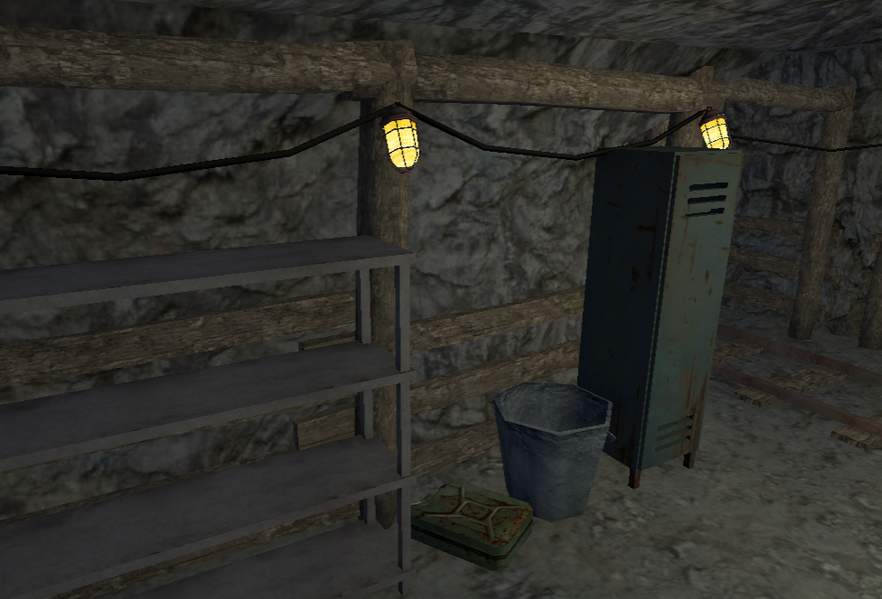
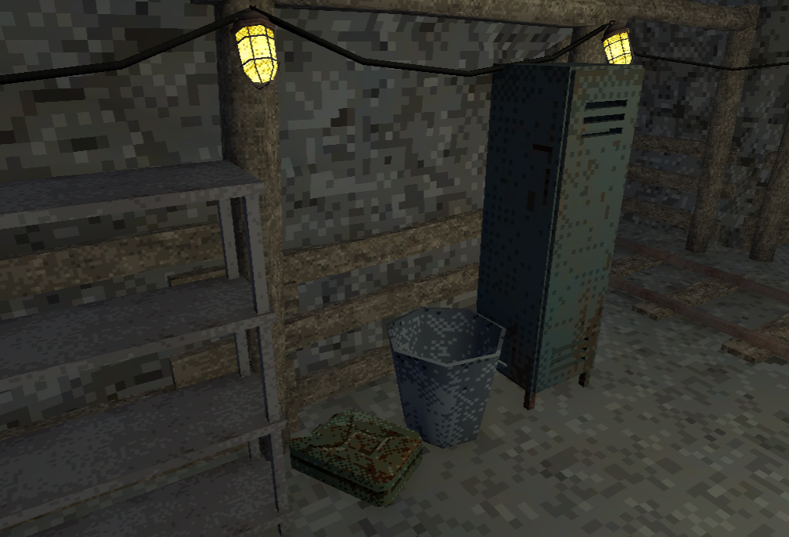

# viol3's Texture Pixelizer

**v0.0.5**

A Unity editor tool that bakes a dithered pixel-art look into your materials' textures. You add a component to an object, tune the settings, press **Apply**, and get a new `<name>_pixelated.png` assigned to the material. Your original texture is never modified.

Think of it as a free, open-source alternative to Puck's Pixelizer.

It's built for retro / PSX-style 3D scenes, where tools that apply the same square pattern everywhere tend to look artificial. Here the tones come from the texture itself, so the dithering stays visible even on near-white or almost flat surfaces.

| Before | After |
|---|---|
|  |  |

*Model in the screenshots by elbolilloduro (CC0).*

## Features

- **Non-destructive.** The source texture is stored on the component, and every Apply starts from it again, so you can keep re-tuning.
- **Tone Bands mode.** Keeps the hue and splits brightness into a few bands across the texture's *own* brightness range. Soft shading on white objects becomes visible dithered bands instead of collapsing into one flat color.
- **Adaptive palette.** Builds a palette from the texture's own colors using k-means.
- **Ordered dithering between the two nearest tones.** The pattern stays clearly visible no matter how close the tones are.
- **Dither patterns:** Bayer 2×2 / 4×4 / 8×8, blue noise, Floyd–Steinberg and Atkinson, plus a randomness control to break up the grid.
- **Downsampling that keeps detail.** *Representative* mode picks the real texel closest to each block's average instead of blurring the block.
- **Live preview** in the inspector before anything is written to disk.
- **Multi-object editing.** Select several objects and apply them all at once.
- **Undo support** for material changes.
- **Scriptable.** A one-call C# API and a batch-mode entry point, so scripts and AI coding agents can pixelize whole prefabs or folders without opening the inspector. See [Scripting and AI agents](#scripting-and-ai-agents).

## Requirements

- Unity 2022.3 or newer (developed and tested on Unity 6).
- A UV-mapped model with an image texture on its material. Flat-color materials, vertex colors and palette atlas textures are not supported (see [Notes and limitations](#notes-and-limitations)).
- Works with any render pipeline. The main texture is detected automatically (`[MainTexture]`, `_BaseMap` or `_MainTex`).

## Installation

**Option A – Package Manager (git URL)**

1. Open *Window → Package Manager*.
2. Click **+ → Add package from git URL…**
3. Paste the repository URL:

```
https://github.com/viol3/texture-pixelizer.git
```

To install a specific version, append a tag, e.g. `https://github.com/viol3/texture-pixelizer.git#v0.0.5`.

**Option B – Copy into the project**

Copy the repository contents into a folder anywhere under your project's `Assets/` folder.

## Quick start

1. Select an object with a **MeshRenderer** (any `Renderer` works).
2. Choose *Add Component → viol3 → Texture Pixelizer*.
3. Optionally drag the texture you want to process into **Source Texture**. If you leave it empty, the material's current texture is used and stored on the first Apply.
4. Click **Preview** to see the result in the inspector. Toggle **Auto** to update the preview as you change settings.
5. Click **Apply**.
   - The tool creates `<texture name>_pixelated.png` next to the source texture. Textures from read-only locations go to `Assets/PixelatedTextures/`.
   - The new texture is imported with Point filtering and no compression.
   - It is assigned to the material's texture slot.
6. To tweak the result, change the settings and click **Apply** again. It always starts from the Source Texture, never from the previous result.
7. Click **Revert to Original** to put the Source Texture back on the material.

## Settings

### Target

| Setting | Description |
|---|---|
| **Source Texture** | The texture to process. Every Apply starts from it. If empty, it is taken from the material. |
| **Material Index** | Which material of the renderer to modify. |
| **Texture Property** | Which shader property to read and write. Defaults to `_BaseMap` (URP). If empty, the shader's main texture is used. |

### Pixelation

| Setting | Description |
|---|---|
| **Pixel Size** | Size of one pixel block, in source texels. `1` = no pixelation. |
| **Downsample Mode** | `Representative` uses the real texel closest to the block average (recommended). `Average` blends the block. `Nearest` uses the center texel. |
| **Keep Low Resolution** | Saves the small texture, which looks identical with Point filtering and uses less memory. Turn it off to upscale back to the original size. |

### Color Adjustments

**Brightness**, **Contrast** and **Saturation** are applied before color reduction.

### Color Reduction

| Setting | Description |
|---|---|
| **Color Mode** | `Tone Bands` (recommended): hue is kept and brightness is split into bands. `Adaptive Palette`: the texture is reduced to N colors taken from itself. `Levels`: fixed levels per RGB channel. `None`: pixelation only. |
| **Tone Bands** | Number of brightness bands. Fewer bands give stronger, more visible dithering. |
| **Auto Range** | Spreads the bands over the texture's own brightness range (1st–99th percentile). This is what makes white objects work. |
| **Min Range** | The smallest brightness range allowed with Auto Range, so nearly flat textures don't turn into pure noise. |
| **Palette Size** | Number of colors in `Adaptive Palette` mode. |
| **Levels** | Levels per channel in `Levels` mode. |

### Dithering

| Setting | Description |
|---|---|
| **Dither Mode** | `Bayer` patterns give regular, classic squares. `BlueNoise` is organic and non-repeating. `FloydSteinberg` and `Atkinson` use error diffusion. |
| **Dither Strength** | `1` = full mixing between tones, `0` = hard posterized bands. |
| **Pattern Randomness** | Mixes noise into the pattern to break up the regular grid. |
| **Adaptive Dither** | Reduces dithering in busy, detailed areas. `0` = uniform everywhere. |
| **Detail Threshold** | How much local contrast counts as "detailed" for Adaptive Dither. |
| **Seed** | Changes the random parts: noise offset and palette initialization. |

### Alpha and Import

| Setting | Description |
|---|---|
| **Hard Alpha / Alpha Cutoff** | Snaps alpha to fully opaque or fully transparent. |
| **Generate Mipmaps** | Mipmaps on the output texture. Turn them off for maximum crispness at a distance, at the cost of some shimmering. |
| **Compress** | Off by default, because compression smears the dither pattern. |

The **Reset Settings** button restores the defaults.

## Tips

- **For the effect to show clearly:** use `Tone Bands` with 3–4 bands, `Bayer 4x4`, and Dither Strength `1`.
- **For bigger squares:** increase **Pixel Size**.
- **For a more hand-made look:** use `BlueNoise`, or raise **Pattern Randomness**.
- **To limit colors as well:** switch to `Adaptive Palette` with 8–16 colors.

## Scripting and AI agents

Everything the inspector does is also available from code, through `Viol3.Pixelizer.Editor.PixelizerApi` (editor only):

```csharp
using Viol3.Pixelizer;
using Viol3.Pixelizer.Editor;

// A texture, material, prefab/model or a whole folder:
PixelizerApi.PixelizeAsset("Assets/Environment", PixelizePresets.Create(PixelizePreset.Strong));

// Scene objects or prefabs, including children:
PixelizerApi.PixelizeGameObject(myObject);

// Undo it:
PixelizerApi.RevertAsset("Assets/Environment");
```

Presets: `Default`, `Subtle`, `Strong`, `Chunky`, `Organic`, `LimitedPalette`.

It also runs from the command line, with the Unity window closed:

```bash
Unity -batchmode -quit -projectPath <project> -logFile -   -executeMethod Viol3.Pixelizer.Editor.PixelizerApi.PixelizeFromCommandLine   -pixelizeTargets "Assets/Models/Tree.prefab;Assets/Environment"   -pixelizePreset Strong -pixelizeSettings "pixelSize=6,ditherMode=BlueNoise"
```

**Using an AI coding assistant?** Point it at [AGENTS.md](AGENTS.md). It covers installing the package by editing `Packages/manifest.json`, the full API, ready-made recipes, and which setting matches which request ("bigger pixels", "less grid-like", ...).

## Notes and limitations

- **Needs a UV-mapped texture.** The tool processes the texture assigned to the material, so the model must be UV-unwrapped and use a real image texture. It does nothing for:
  - materials that only use a flat color (no texture),
  - vertex-colored models,
  - small palette/gradient atlas textures where each face maps to a single color cell. There are no tones inside a cell to dither, so faces stay flat.
- **Shared materials:** The tool edits the material asset, so every object using that material shows the pixelated texture. The inspector warns you when this is the case.
- **Shared source textures:** Objects that use the same source texture write to the same `_pixelated.png` file, so the last Apply wins.
- **Materials embedded in a model file** (FBX, etc.) are read-only. Extract them first: select the model, then *Import Settings → Materials → Extract Materials*.
- **Editor-time only:** Processing happens in the editor (including `PixelizerApi`). Nothing runs at runtime, and the component itself has no cost in builds.

## License

Released under the [MIT License](LICENSE.md). You're free to use it in personal and commercial projects, modify it and redistribute it, as long as you keep the copyright and license notice (i.e. credit viol3).
